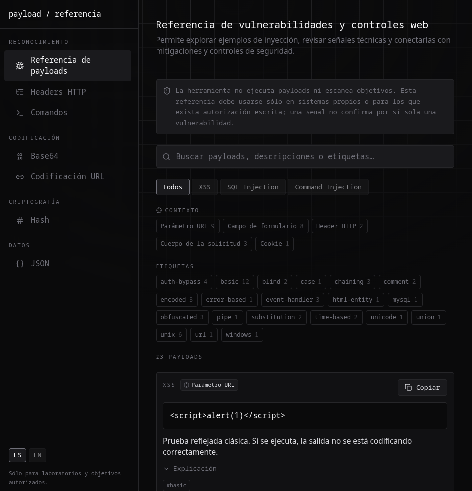

# Web Vulnerability Control Mapping

[Español](README.md) | **English**

## What it is

WVCM is an educational reference that connects basic Cross-Site Scripting
(XSS), SQL Injection, and Command Injection examples with technical signals,
mitigations, and security-control relationships. It is intended for students,
analysts, and people preparing an authorized assessment.

## Demo

[Open the demo](https://wvcm.sggaray.com)

## What you can do

- Explore static payloads and filter them by category, context, or tag.
- Review the conditions each example requires and the signal it might produce.
- Analyze HTTP response text and observe a limited set of security headers.
- Encode and decode Base64, URLs, and JSON with data-fidelity checks.
- Compute MD5, SHA-1, and SHA-256 hashes in the browser. MD5 and SHA-1 are for
  reference and compatibility only, not for passwords or signatures.
- Build nmap and curl commands to copy and run in your own lab.
- Consult conceptual mappings to OWASP Top 10, NIST SP 800-53, and ISO/IEC
  27001. 

## Included tools

Payload Reference, Header Analyzer, Hash, Base64, URL, JSON, and Commands. The
interface is available in Argentine Spanish and English; the ES/EN selector
stores the preference in the browser.

## How evidence is interpreted

Header Analyzer states describe only what was observed in the pasted response.
A present header does not automatically mean that protection is effective, and
an absent header does not confirm a vulnerability.

A mapping indicates a relevant relationship, but does not show that the
control is implemented or effective, and does not determine compliance.
Signals must be compared, repeated, and corroborated in their actual technical
context.

## What it does not prove

WVCM:

- does not execute payloads;
- does not scan targets;
- does not confirm vulnerabilities or exploitation;
- does not determine control effectiveness;
- does not determine compliance;
- uses mappings as contextual support, not implementation evidence.

## Data flow

All seven tools process input locally in the browser. Hash computes SHA-1 and
SHA-256 with Web Crypto and MD5 with its own implementation (`lib/md5.ts`);
the text is not sent to any server and is not stored. Web Crypto is only
available in secure contexts (HTTPS or `localhost`); elsewhere, Hash shows an
error instead of results.

Local processing does not mean offline use: the application is downloaded from
the server each time it is opened, and it has no service worker or offline
cache.

## Authorized use

Use WVCM only on systems you own or have written permission to test. The
project is an educational aid and does not replace a professional assessment.

## License

MIT
