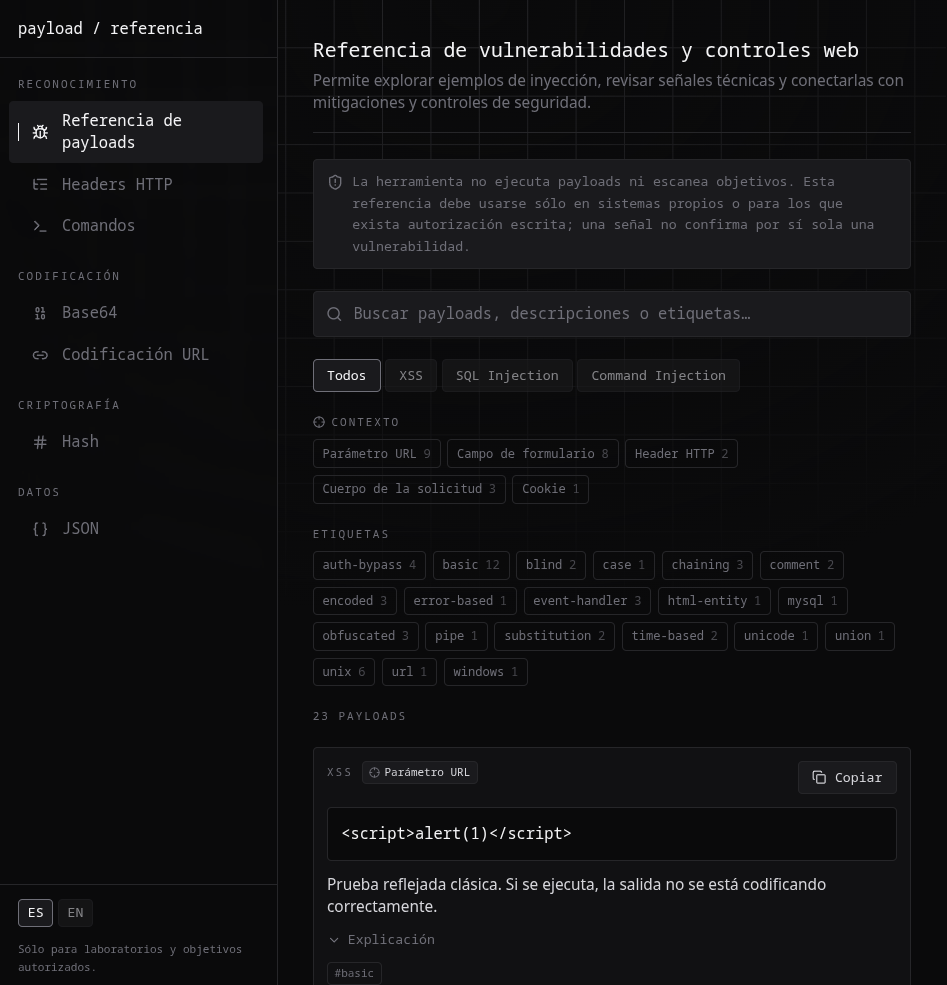

# Web Vulnerability Control Mapping

**Español** | [English](README.en.md)

## Qué es

WVCM es una referencia educativa que conecta ejemplos básicos de Cross-Site
Scripting (XSS), SQL Injection y Command Injection con señales técnicas,
mitigaciones y relaciones con controles de seguridad. Está pensada para
estudiantes, analistas y personas que preparan una evaluación autorizada.

## Demo

[Abrir la demo](https://wvcm.sggaray.com)

## Qué podés hacer

- Explorar payloads estáticos y filtrarlos por categoría, contexto o etiqueta.
- Revisar qué condiciones necesita cada ejemplo y qué señal podría producir.
- Analizar texto de respuestas HTTP y observar un conjunto acotado de headers
  de seguridad.
- Codificar y decodificar Base64, URLs y JSON con controles de fidelidad de
  datos.
- Calcular hashes MD5, SHA-1 y SHA-256 en el navegador. MD5 y SHA-1 sirven
  sólo como referencia o por compatibilidad, no para contraseñas ni firmas.
- Armar comandos nmap y curl para copiar y ejecutar en tu propio laboratorio.
- Consultar mappings conceptuales con OWASP Top 10, NIST SP 800-53 e ISO/IEC
  27001. 

## Herramientas incluidas

Payload Reference, Analizador de headers HTTP, Hash, Base64, URL, JSON y
Commands. La interfaz está disponible en español e inglés; el
selector ES/EN guarda la preferencia en el navegador.

## Cómo interpreta la evidencia

Los estados del Analizador de headers HTTP describen únicamente lo observado
en la respuesta pegada. Que un header esté presente no significa que la
protección sea efectiva, y que no se observe no confirma una vulnerabilidad.

Un mapping indica una relación relevante, pero no demuestra que el control
esté implementado, sea efectivo ni determina compliance. Las señales deben
compararse, repetirse y corroborarse dentro del contexto técnico real.

## Qué no demuestra

WVCM:

- no ejecuta payloads;
- no escanea objetivos;
- no confirma vulnerabilidades ni explotación;
- no determina la efectividad de controles;
- no determina compliance;
- usa mappings como apoyo contextual, no como evidencia de implementación.

## Flujo de datos

Las siete herramientas procesan la entrada localmente en el navegador. Hash
calcula SHA-1 y SHA-256 con Web Crypto y MD5 con una implementación propia
(`lib/md5.ts`); el texto no se envía a ningún servidor ni se almacena. Web
Crypto sólo está disponible en contextos seguros (HTTPS o `localhost`); fuera
de ellos, Hash muestra un error en lugar de resultados.

Procesamiento local no significa funcionamiento sin conexión: la aplicación se
descarga desde el servidor cada vez que se abre y no incluye service worker ni
caché offline.

## Uso autorizado

Usá WVCM sólo en sistemas propios o para los que tengas autorización escrita.
El proyecto es una ayuda educativa y no reemplaza una evaluación profesional.

## Licencia

MIT
